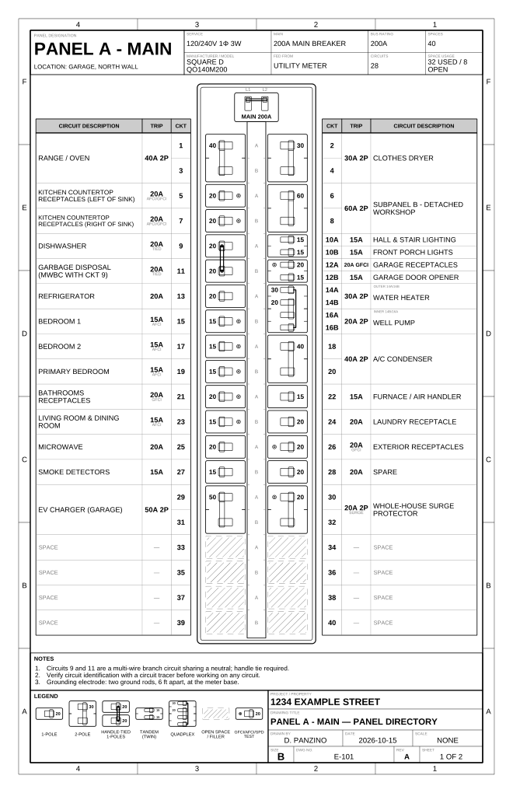

# Panel Directory Drafter

A web app for drawing household breaker panel directories on **ANSI B (11×17 in) portrait** sheets.
The drawing shows the breakers that are actually in the box (1-pole, 2-pole, 3-pole, handle-tied,
tandem, quadplex, open spaces / fillers, GFCI/AFCI/dual-function/surge), with a circuit directory
lined up next to each column. The output is a DXF made for plotting.



## Run

```bash
pip install -r requirements.txt
python app.py            # http://127.0.0.1:5000   (--host 0.0.0.0 to reach it from your LAN)
```

## Using it

* **Panel information**: name, location, service, main breaker or main lugs, bus rating, number of
  spaces, and numbering scheme (*odd left / even right*, or *down the left then down the right*).
* **Breakers**: the editor is laid out like the panel itself. Set each space's type, and a 2-pole,
  3-pole or quad takes the spaces below it. A **tie ↓** checkbox shows up on a 1-pole breaker when
  the breaker below it is also a 1-pole (e.g. a multi-wire branch circuit).
* **Notes / Title block**: notes print above the legend. The title block holds project, drawn by,
  date, dwg no., rev and sheet.
* Several panels are kept in the browser (localStorage). Use **Save JSON / Import JSON** for real
  backups and for moving configs between machines.
* Downloads: **DXF** (primary), **PDF**, and **DWG** when available (see below).

## The DXF

* Inches, drawn 1:1 in model space and sized to the 11×17 sheet. A paper-space layout named
  **"ANSI B"** has an 11×17 page setup and a 1:1 viewport, so plotting it gives full-scale output.
  From model space, plot "Extents" or "Window" at 1:1.
* Layers are split by function (`FRAME`, `TITLE`, `ENCLOSURE`, `BREAKER`, `HANDLE`, `TIE`,
  `TABLE`, `TABLE-GRID`, `HATCH`, `TEXT`, ...). Each layer sets its own lineweight. Turn on
  lineweight display and plot with `monochrome.ctb` for a black-and-white print.
* Text uses Arial (`arial.ttf` / `arialbd.ttf`). Text widths are measured with Liberation Sans,
  which has the same metrics as Arial, so labels fit their cells. Labels that are too long shrink,
  then wrap, then get truncated with "…".

## DWG

DXF opens in AutoCAD, BricsCAD, DraftSight, LibreCAD, QCAD, etc. To export DWG directly, install the
free [ODA File Converter](https://www.opendesign.com/guestfiles/oda_file_converter) on the machine
that runs the server. The DWG button turns on when it is detected (`ezdxf.addons.odafc`).

## CLI

```bash
python -m panelgen examples/main_panel.json -o panel.dxf   # or .pdf / .svg / .dwg
```

## Config format

See `examples/main_panel.json`. Each breaker is listed by the first (top) space it occupies:

| kind     | spaces | fields                                                     |
|----------|--------|------------------------------------------------------------|
| `single` | 1      | `amps`, `label`, `feature`, `tie_below`                    |
| `double` | 2      | `amps`, `label`, `feature`                                 |
| `triple` | 3      | `amps`, `label`, `feature`                                 |
| `tandem` | 1      | `a` / `b`: `{amps, label, feature}`                        |
| `quad`   | 2      | `a` = outer 2-pole, `b` = inner 2-pole: `{amps, label}`    |

`feature` is one of `""`, `GFCI`, `AFCI`, `DF` (dual function), `SPD`. Any space not listed is drawn
as an open space / filler.

## Tests

```bash
python -m pytest tests
```
