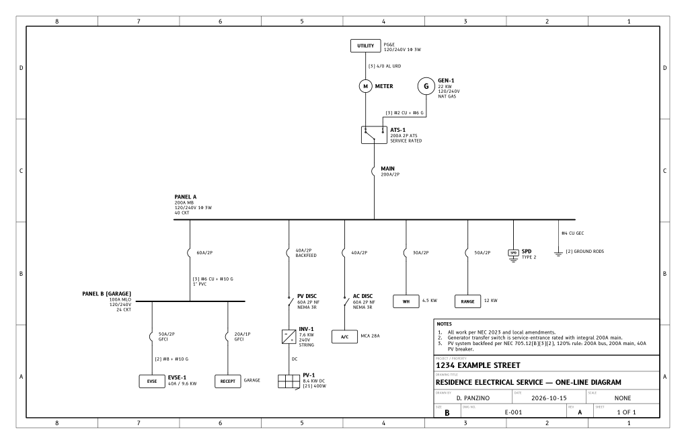
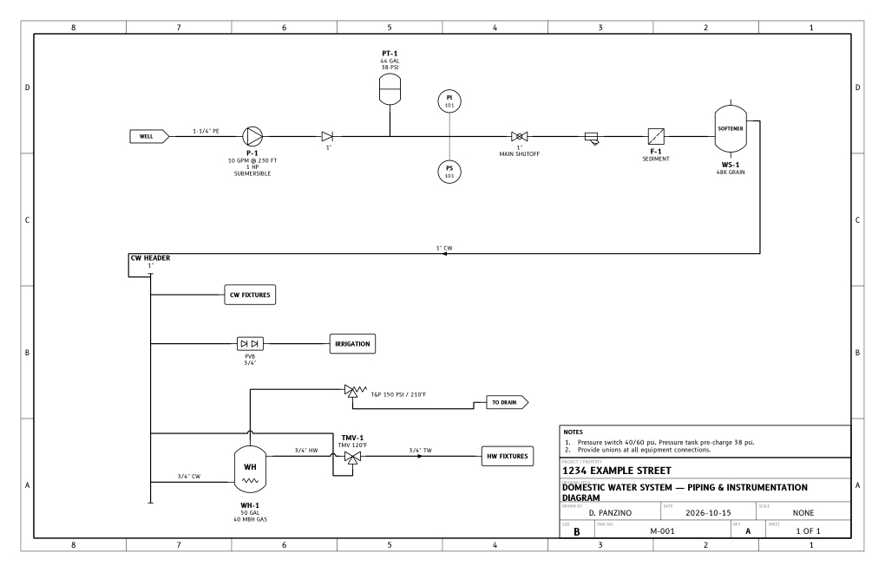

# Diagram Drafter

A single-file web tool for electrical **one-line diagrams** and **P&IDs** on **ANSI B (17×11)
landscape** sheets. It is aimed at residential work, but its symbol libraries also cover light
commercial and industrial equipment. You place symbols and connect them, and the tool handles the
drafting: spacing, alignment, right-angle routing, labels, border, title block, and DXF output.

| One-line | P&ID |
|---|---|
|  |  |

## Run

Open **`diagram-drafter.html`** in a browser. There's no server or install, and it works offline.
The examples load on first start.

## Laying out a drawing

* **Add connected.** Select a symbol and click a palette item. The new symbol is placed downstream
  of the selection, clear of it, and wired to it. Select a bus or header and each click adds another
  branch beside the others. Most drawings can be built this way without dragging anything.
* **Insert into a line.** Select a wire or pipe and click a valve, breaker, disconnect, etc. It is
  inserted into the line and the line is split. Dropping a free symbol onto a line does the same.
  Deleting an inline device rejoins the line.
* **Auto-arrange (A).** Lays out the whole drawing:
  * It grows a tree from the sources (utility, generator, PV, supply, well), using which side of each
    symbol a connection uses. So a generator feeding a transfer switch lands beside the utility, a
    backfed PV breaker hangs under the panel with the array below it, and a hydronic loop closes back
    around to the boiler.
  * Runs are aligned port-to-port, so they're straight.
  * Branches are packed so they nest without overlapping.
  * Buses and headers stretch to span their branches.
  * Gauges, instruments, vents and expansion tanks sit beside their tap.
  * Spacing is then scaled to fill the sheet's free area, which is L-shaped around the title block.
  * Long runs fold onto a second row instead of shrinking. Symbols scale down only as a last resort,
    and you're told when a drawing really needs a second sheet.
* **Routing.** Connections are routed at right angles, centred in the channels between symbols, and
  kept off symbols and text. Crossings get a hop or a break (your choice), and the lighter line
  yields.
* **Clearances.** Every symbol has a clearance zone that includes its label. Dropped symbols are
  nudged clear of their neighbours ("Avoid overlaps"), and "Show clearances" draws the zones.
  While you drag, a symbol snaps so its connections run straight and it lines up with nearby symbols.
* **Check.** Lists overlaps, items outside the border or over the title block, connections that
  couldn't be routed cleanly, labels that hit symbols, unconnected inlets and outlets, and
  duplicate tags.

Other controls:

* Connect two symbols by dragging from a port (the small circles on hover) to another symbol or port.
* Select a symbol to edit its tag, ratings (which make up its label), extra text and label position.
* Select a line to set its type, label (conductors and raceway, or pipe size and service) and flow
  arrow.
* With nothing selected, the panel holds drawing settings: flow direction, spacing
  (compact/normal/airy), symbol size, crossing style, font (B612, Jost or Arial), capitals, title
  block and notes.
* Keys: **R** rotate, **F** mirror, **Del** delete, **Ctrl+Z / Ctrl+Shift+Z** undo / redo,
  **Ctrl+C / V / D** copy, paste, duplicate, **arrows** nudge, **Ctrl+wheel** zoom, **wheel** or
  **Space+drag** pan, **0** fit.

Drawings are kept in the browser (localStorage). Use **Save JSON / Import** for backups and for
moving drawings between machines.

## Output

* **Download DXF.** AutoCAD 2013 format, inches, drawn 1:1. It includes an **"ANSI B"** paper-space
  layout at 17×11 with a 1:1 viewport. Entities are on layers by function (`SYMBOL`, `BUS`, `WIRE`,
  `WIRE-CTRL`, `PIPE-MAJOR`, `PIPE-MINOR`, `SIGNAL`, `SIGNAL-ELEC`, `TEXT`, `LABEL`, `FRAME`,
  `TITLE`, ...) and each layer carries its lineweight. Plot with `monochrome.ctb`.
* **Print / PDF.** Prints the sheet at 17×11. Choose "Save as PDF" in the print dialog (paper size
  Tabloid / 11×17 landscape, margins none).
* **Fonts.** B612 and Jost are embedded for the preview and print. The DXF only names the font files,
  so install them on the CAD machine for the text to fit as drawn. The links are under the font
  picker, and the files are in `fonts/`.

## Symbols

**One-line (ANSI/IEEE style):**
* Sources: utility, generator, PV, battery/ESS.
* Distribution: meter, panelboard/switchboard/MCC bus, transfer switch, transformer, inverter.
* Protection: molded-case breaker, power breaker, fuse, fused and non-fused disconnects, surge
  protector, contactor, CT.
* Loads and equipment: boxes with presets (EVSE, A/C, heat pump, WH, range, ...), motor.
* Inline devices: VFD, UPS, combiner, RSD, ...
* Other: ground, tap, off-sheet connector.

**P&ID (ISA style):**
* Valves: gate, ball, globe, butterfly, check, balancing, 3-way/TMV, control, solenoid, motorized,
  PRV, relief/T&P, backflow preventers, drain/hose bib.
* Inline: strainer, filter, meter, union, reducer.
* Equipment: pump/circulator, tanks, expansion/pressure tank, water heater, boiler, heat exchanger,
  coil, baseboard, compressor, generic equipment boxes.
* Instruments: ISA bubbles (field, panel, aux, DCS, PLC), air vent.
* Lines: supply/source, off-sheet, header/manifold, tee.
* Line types: major/minor/buried pipe, instrument connection, electric, pneumatic, capillary and
  data signals.

## Development

The app is built from `src/` into `diagram-drafter.html`. Edit the sources, then rebuild:

```bash
python tools/build.py            # standard library only
```

* `src/js/`:
  * `00-util` helpers;
  * `01-fonts`;
  * `02-sheet` (entities, text fitting, symbol transforms);
  * `03-symbols` (libraries, line types);
  * `04-model` (document, geometry, labels);
  * `05-render`;
  * `06-output` (SVG, DXF);
  * `07-router`;
  * `08-layout` (auto-arrange);
  * `09-editor`;
  * `10-ui`.
* `tools/make_dxf_template.py` (needs ezdxf) regenerates `src/dxf_template.json`: header, layers,
  linetypes, text styles and the ANSI B layout.
* `tools/check.py` (needs playwright and ezdxf) loads the built page headless. It auto-arranges every
  example in both flow directions, plus a deliberately oversized drawing, and fails on JS errors,
  unrouted connections, layout-check errors, or DXF that fails ezdxf's validation check or leaves the
  sheet. `--out DIR` writes the example DXF and PDF.
* `examples/*.json` are the built-in examples. The build embeds them.
