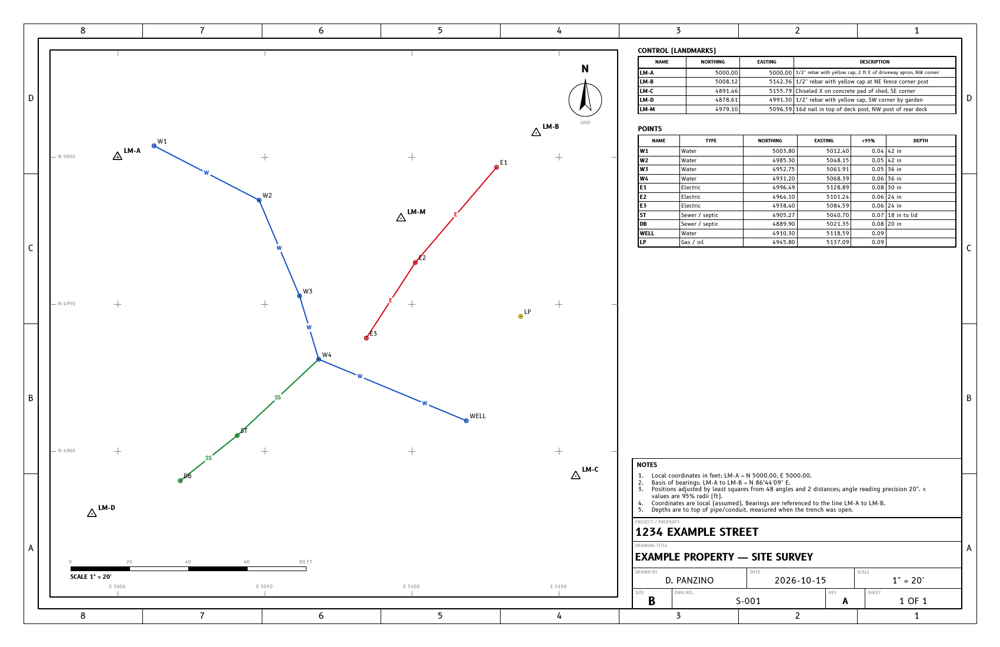

# Site Survey Log

A single-file web tool for recording transit (or theodolite) angles between fixed landmarks on a
property, reducing them to coordinates, and turning the coordinates back into **"set up here, sight
there, turn to this angle"** instructions for finding a buried line again years later.



## Run

Open **`site-survey.html`** in a browser. It works offline with no install. Only the optional
satellite imagery needs a connection. **Example** in the toolbar loads a five-landmark property with
water, electric, septic and gas features, a house, a deck and a shed. Its latitudes/longitudes
are made up, so the imagery behind it is just a park lawn.

Projects are kept in the browser (localStorage). Use **Save JSON / Import** for backups. The JSON is
the field book, so keep a copy with the house papers.

## The idea, and what it takes to make it work

You set up on a landmark, zero the circle on a second landmark (the backsight), and read the angle
to a target. Two such rays from two landmarks cross at the target. That is the core, but angles
alone leave three things undetermined, and the tool handles each:

| Missing | Why | What the tool does |
|---|---|---|
| **Position** | Angles don't say where the network is | The origin landmark is held at a chosen local N/E (default 5000, 5000). |
| **Orientation** | Angles are relative to the backsight | The line origin → orient landmark is given a bearing (magnetic, from a plat, or just assume N 0°E). |
| **Scale** | A similar triangle twice as big has the same angles | **Tape at least one distance** between two landmarks. Without it the network is drawn at an arbitrary size and flagged. Any extra distances (landmark to landmark, or a taped tie to a point) are used as checks. |

Your rule ("every landmark sees two others, every point sees two landmarks") is the minimum for
a unique solution. The tool goes further than that:

* **Solvability.** After every edit it works out what can be located and how. For anything that
  can't be located it says why and what to add, for example "W4 is sighted only from LM-B: sight it
  from one more landmark."
* **Least-squares adjustment.** All angles and distances are combined in one weighted
  Gauss-Newton adjustment. Angle weights come from the instrument precision you choose. An angle is the
  difference of two readings, so its σ is √2 × the reading σ. Distance weights are ±(fixed + d/ratio).
  Each position gets a 95 % error ellipse. ±95 % in the tables is the ellipse semi-major axis.
* **Weak geometry.** Two rays crossing at less than ~25° are flagged, because the point slides along
  the rays.
* **Blunder detection.** A misread or mis-booked angle (a wrong degree, a 20' instead of a 40') is
  the real risk. Standardized residuals are tested with iterative data snooping: the worst reading
  is flagged, removed and the network re-adjusted, up to three rounds. The message names the
  reading and estimates the size of the error. When the geometry can only tell that one of a group
  is wrong, it says so instead of guessing. Any reading can be ticked "ignore" to see the effect.
* **"Checked" vs "no check".** Two rays always intersect, so a single misread on a two-ray point is
  invisible. A point is marked **checked** when the worst error that could go *undetected*
  (the 4.1 σ / √r minimal detectable blunder, propagated into that point's position) moves it no
  more than max(0.15 ft, 3 × its 95 % radius). In practice: three or more sightings from well-spread
  directions. The badge tooltip gives the actual worst-case shift. In the example, the house hides
  W3 and E3 from all but two landmarks, and W4 and DB have three sightings that are too poorly
  spread, so these four are left unchecked.

## Workflow

1. **Landmarks.** Name and describe each one well enough to find it in 20 years ("½" rebar with
   yellow cap, 2 ft E of driveway apron"). Choose the origin, orient landmark and bearing on the
   **Project** tab, along with units (ft/m), circle direction (cw/ccw) and instrument precision
   (presets from a 5' builder's level to a 2" total station).
2. **Field book.** One setup per instrument station: date, station, backsight, backsight reading
   (usually 0°00'00"), then one row per target with the circle reading and an optional taped
   distance. Angles can be typed as `123 45 20`, `123-45-20`, `123°45'20"` or `123.7556`. **Enter**
   adds a row, and "+ New point…" in the target list creates a point on the spot. Taped
   landmark-to-landmark distances go in the baselines list. The computed angle right and its
   residual are shown live beside each reading.
3. **Points / Lines.** Give points a type (APWA utility colours: electric red, gas yellow, comms
   orange, water blue, sewer green, storm, irrigation purple), depth and description. Lines connect
   points in order. Use them for a trench route.
4. **Obstacles.** Outline buildings, sheds, hedges and solid walls (see below).
5. **Find.** Pick a point, a distance along a line ("12 ft along the water line from W2"),
   typed coordinates, a latitude/longitude, or click the map (for "I want to dig here, what's under
   it?"). The tool picks the two setups whose sight lines cross most squarely and are not blocked
   by an obstacle, preferring stations that have already sighted that point so the line of sight is
   known to be clear. It gives backsight, angle to turn and distance along the line, the expected
   95 % uncertainty where they cross, and taped distances from nearby landmarks as an independent
   check. All other setups are listed too, with any that are blocked and by what.

## Satellite imagery (georeference)

Give some landmarks a latitude/longitude and the map gets a semi-transparent satellite underlay.
The opacity slider is in the map toolbar.

* **Where the lat/lon comes from.** You can stand on the mark with a phone GPS app, or paste
  `lat, lon` copied from a map app into the latitude box (it splits itself). Once imagery shows,
  **Pick** puts a mark you can see in the image (a slab corner, a fence corner post) by clicking it.
  Each entry has a source: phone/handheld ±3 m, picked on imagery ±0.6 m, or survey-grade GPS
  ±5 cm. The source sets the entry's weight in the fit.
* **The fit.** This is a weighted least-squares 2D fit of the surveyed landmark positions onto
  the lat/lon. The lat/lon are first converted to a WGS 84 local tangent plane. The fit is
  rigid (shift and rotation only), because your angles and tape are far more precise than any
  phone GPS. If nothing has been taped yet, the scale is fitted too. The Project tab reports:
  * the rotation as "grid north is x° west/east of true north", with its 95 % uncertainty;
  * the RMS misfit;
  * each landmark's misfit on its card.

  A fix that disagrees by more than about 3.5σ, with three or more fixes, is flagged.
* **One fix** pins the imagery with grid north taken as true north. **Two** fix the rotation
  but can't check each other. **Three or more** give a check.
* **Imagery.** Choose Esri World Imagery (worldwide), USGS orthoimagery (US only) or any
  `{z}/{x}/{y}` tile server. Tiles are drawn through the fit, so they rotate with it. The tile
  images are fetched by your browser. Check the provider's terms for anything beyond personal use.
* **Uses.**
  * The printed plan can include the imagery (Project tab), clipped to the map frame. DXF output
    never includes it.
  * The plan gets a true-north tick and a note giving the grid rotation.
  * The report adds lat/lon to the landmarks table and to each find card, which is enough to walk
    to the spot with a phone.
  * The CSV gets latitude/longitude columns.
  * **Export → Google Earth (KML)** writes landmarks, points, lines and obstacles.
  * Find can take a lat/lon, for example from a utility locate ticket.

## Obstacles

On the **Obstacles** tab, add a building, shed/garage/deck, trees/hedge, wall/solid fence, or
other. Click **Draw**, then click its corners on the map, over the imagery if you have it.
Clicking a landmark or point makes that corner follow its surveyed position. Drag the square
handles to adjust, click a corner's coordinates to type them, and press Esc when done.

* An obstacle that **blocks sight** rules out any Find setup whose line to the spot passes
  through it. The line to that setup's backsight is checked too (another backsight is used if one
  is clear). Tape ties are checked as well. Crossings within 0.25 ft (8 cm) of either end don't
  count, so a mark on a wall or a deck post can still be used.
* Untick "Blocks sight" for outlines you can see over, such as a patio or a low deck. They are
  still drawn.
* If a field-book sighting passes through a blocking obstacle, you get a note. Either the outline
  is wrong or the building is newer than the sighting.
* Obstacles are drawn on the map, plan, report figure and both DXFs (layers `OBSTACLE`,
  `OBSTACLE-VEG`, `OBSTACLE-LOW`, `OBSTACLE-FILL`) and exported to KML.

## Outputs

* **Plan (Print / DXF).** ANSI B (17 × 11) landscape sheet with zone border, plotted at an
  engineering scale (1" = 5' … 2000', or 1:n for metres) picked to fit or set by you. It has a
  coordinate grid, north arrow, scale bar, utility lines with type letters, CONTROL and POINTS
  tables, a notes block (datum and method notes are generated) and a title block. Sight lines can
  be shown or hidden. DXF is R2013 in inches, with layers by function and utility.
* **Report (Print).** US Letter, several pages: site figure, datum and solution quality, landmark and
  point coordinates with ±95 % and check status, lines with lengths, the full field book with
  residuals and flags, and a **"how to find it" card for every point**. This is the document to
  keep.
* **DXF 1:1.** Real-world coordinates in feet or metres (`$INSUNITS` set), with landmarks, points,
  lines and labels on layers. It drops straight into CAD or GIS over a site plan.
* **CSV.** PNEZD order (point, northing, easting, blank elevation, description), then kind, type,
  depth, ±95 % and check, plus latitude/longitude when georeferenced. Most CAD and data-collector
  software imports it directly.
* **KML.** For Google Earth, when georeferenced.

Example outputs are in [`examples/output/`](examples/output/):
[plan PDF](examples/output/example_property_plan.pdf),
[report PDF](examples/output/example_property_report.pdf),
[plan DXF](examples/output/example_property_plan.dxf),
[1:1 DXF](examples/output/example_property_1to1.dxf),
[CSV](examples/output/example_property.csv),
[KML](examples/output/example_property.kml).

## Field tips

* Read each angle twice: once face left, once face right (or once on each of two zero settings)
  and book the mean. Most blunders die here.
* Close the horizon: at each setup, also sight every other visible landmark. Those readings cost
  nothing and are what lets the adjustment find a bad reading.
* Sight each buried point from three landmarks spread at least 30–60° apart. Two only locates it.
  Three checks it.
* Re-tape the scale baseline both directions. Its error scales the whole site.
* Plumb on a cap or nail, not the side of a post. A 1" centering error at 50 ft is about 6'
  of angle.
* For phone GPS fixes, let the position settle for a minute on each mark, and give fixes to
  landmarks that are far apart. The rotation is only as good as the fix error divided by their
  spacing.

## Development

The app is built from `src/` into `site-survey.html`:

```bash
python tools/build.py               # standard library only
```

* `src/js/`: `00-util`, `01-fonts`, `02-sheet` (drawing entities), `03-angles` (parsing and formatting
  of DMS and bearings), `04-model` (project, observations), `05-solver` (approximations, least
  squares, data snooping, reliability), `06-find`, `06-geo` (lat/lon fit, imagery tiles, KML),
  `06-obstacles` (sight-line blocking), `07-output` (SVG, DXF), `08-site` (plan sheet, 1:1 DXF,
  CSV), `09-map`, `10-report`, `11-ui`.
* `python tools/build.py --hosted OUT.html` builds the claude.ai artifact version. The host
  supplies the page skeleton, so this version has none of its own. It saves surveys to the
  viewer's account (`db` capability) rather than only to the browser. Files go through the host's
  save prompt, with DXF and KML wrapped in a .zip because those extensions aren't on its list.
  Print is replaced by "Plan (SVG)" and "Report (HTML)" files you open and print. Dialogs are drawn
  in the page. Imagery is off, because a hosted page can't load tiles from other sites.
* `tools/make_dxf_template.py` (needs ezdxf) regenerates `src/dxf_template.json`.
* `tools/make_example.py` builds `examples/example_property.json` from known true coordinates with
  simulated reading noise. It books only sight lines that clear the house and shed, and adds
  phone-grade lat/lon at a known grid rotation. `--truth` prints the true coordinates and
  georeference.
* `tools/check.py` (needs playwright and ezdxf) loads the built page headless. It checks:
  * the example solves to within each point's 95 % radius of truth;
  * the find instructions reproduce each point and never use a line through a building;
  * the georeference recovers the true grid rotation, imagery tiles land within 0.05 px of where
    the fit puts them, and GPS sets a sensible scale when nothing is taped. Tiles are served
    locally, so the tile servers are never contacted;
  * drawing and dragging an obstacle, and picking a landmark on the imagery, work in the UI;
  * an injected misread angle is flagged;
  * a degraded survey (no distance, a single sighting, a bad entry) gives the right advice;
  * the DXF files pass ezdxf's audit with the correct units, and the KML parses;
  * there are no JS errors.
* `tools/render_examples.py` (needs playwright and poppler) writes `examples/output/`.
