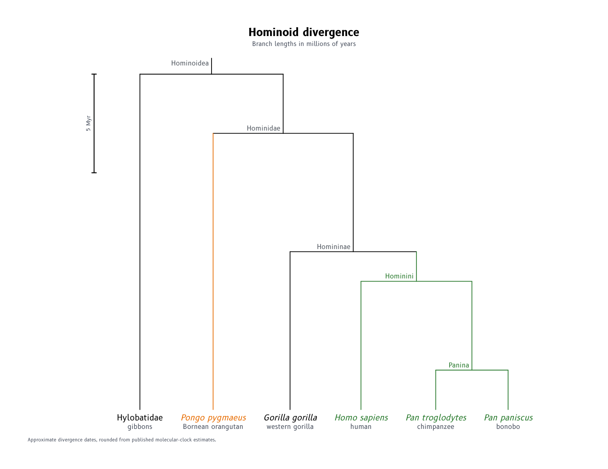
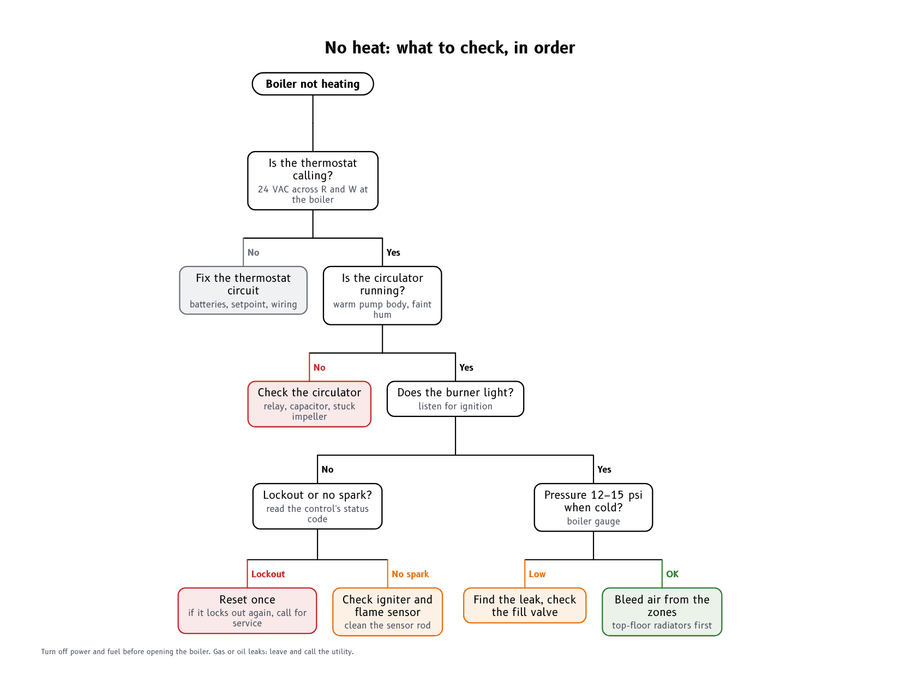
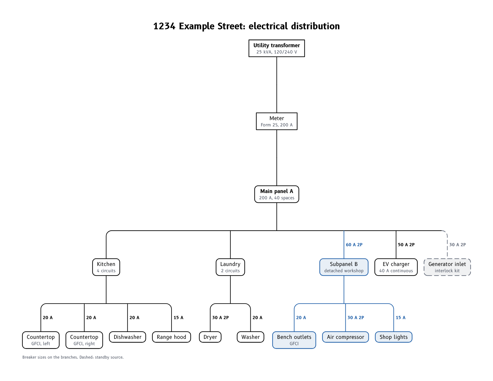

# Tree Drafter

A single-file web tool for drawing trees that flow downward: phylogenetic trees, decision
flowcharts and hierarchies. You type an indented outline. The tool lays the tree out, fits it to
a page and draws the connectors.

| Phylogram | Decision flowchart | Hierarchy |
|---|---|---|
|  |  |  |

## Run

Open **`tree-drafter.html`** in a browser. It needs no install and works offline. The three
examples above load on first start. More are under **New ▾**.

Trees are kept in the browser (localStorage). Use **Save JSON / Import** for backups.

## The outline

One node per line. Indent a line (Tab, or spaces) to make it a child of the line above.

```
Boiler not heating {pill}
  Is the thermostat calling? | 24 VAC across R and W
    [No] Fix the thermostat circuit {gray}
    [Yes] Is the circulator running?
```

| Syntax | Meaning |
|---|---|
| `Label \| detail` | A second, smaller line of text in the box or under the label. |
| `[Yes] Label` | A label on the branch coming into the node. |
| `_Homo sapiens_` | Italic label, for species names. |
| `{2.5}` | Branch length, used by the phylogram layout. |
| `{green}`, `{#c62828}` | Colours this branch and everything below it, for clades or outcomes. |
| `{box}`, `{pill}`, `{plain}` | Box shape. The default is a rounded box. |
| `{dashed}`, `{bold}`, `{italic}` | Line and text styles. Options combine: `{1.5 green dashed}`. |
| `\n` | A line break inside a label. |
| `{0.3}` alone | A node with no label (a bare junction). |
| `// note` | A comment line. It is not drawn. |

**Tab** and **Shift+Tab** indent and outdent the selected lines, and **Enter** keeps the current
indent. Clicking a box in the preview selects its line. Mistakes, such as an unknown option, are
listed under the editor with their line numbers.

## Layouts

* **Flowchart (compact).** The tidy-tree algorithm. Each subtree is packed as close to its
  neighbours as their row-by-row outlines allow, and each parent is centred over its children.
  It suits decision trees and org-chart-style hierarchies.
* **Dendrogram.** Every leaf gets its own slot across the page and parents sit over the middle
  of their children. Each level is one row.
* **Cladogram.** Like the dendrogram, but every leaf sits on the bottom row, so internal nodes
  sit at their height above the leaves.
* **Phylogram.** Depth is the sum of the branch lengths (`{…}`, default 1). The tree fills the
  page height. A scale bar is labelled with the unit you give, such as "Myr" or
  "substitutions/site". Leaf labels can be aligned at the bottom with dotted leaders.

Other settings:

* **Node style.** **Boxes** draws every node as a box. **Labels only** gives the usual
  phylogenetic look: internal nodes are junctions with small labels, and leaves are labels under
  the branch ends. Leaf labels can be turned vertical when there are many leaves. Phylograms
  always use labels.
* **Connectors.** Square brackets (the rectangular dendrogram style), rounded brackets, or
  straight lines.
* **Edge labels** sit beside the drop into the child. Layout reserves room for them.
* **Colours** are inherited down the tree. A branch takes its child's colour, and a bar takes its
  parent's colour, so a coloured clade reads as one block.

## Page and output

The tree is fitted to a page: Letter, Legal, Tabloid/ANSI B, ANSI C, A4 or A3, in portrait or
landscape. A title, subtitle and footnote can be added. The tree is only ever shrunk, never
enlarged. The bar above the preview shows the resulting text size, and you are warned below 6 pt.
"Stretch to fill" spreads the levels out to the page height.

* **Print / PDF** prints at the page size. Choose "Save as PDF" in the print dialog.
* **SVG** keeps the vector drawing with its fonts embedded, for documents and slides.
* **PNG** is a 200 dpi image.
* **DXF** is R2013 in inches at 1:1. It uses layers `BRANCH`, `BRANCH-DASHED`, `NODE`, `TEXT`,
  `TEXT-MINOR`, `LABEL`, `LEADER`, `SCALE` and `TITLE`, plus the page outline on the non-plotting
  `PAGE` layer. Colours are true colours, and italic text is set with a 15° oblique.
* **Newick** export and import (`.nwk`, `.tre`, or **Paste Newick**) connect it to phylogenetics
  software. Imported trees with branch lengths open as phylograms. Quoted labels, `[comments]`
  and underscores-as-spaces follow the Newick conventions.

## Development

The app is built from `src/` into `tree-drafter.html`:

```bash
python tools/build.py                     # tree-drafter.html (standard library only)
python tools/build.py --hosted OUT.html   # the claude.ai artifact version
```

* `src/js/`:
  * `00-util`
  * `01-fonts`: measurement and wrapping
  * `02-parse`: outline syntax and Newick
  * `03-layout`: tidy tree, leaf slots, levels and branch lengths
  * `04-render`: page fitting, connectors, boxes and labels
  * `05-output`: SVG, PNG and DXF
  * `08-host`: dialogs, file saving and account storage when hosted
  * `10-ui`
* `tools/make_dxf_template.py` (needs ezdxf) regenerates `src/dxf_template.json`.
* `tools/check.py` (needs playwright and ezdxf) checks every example and a large random tree in
  every layout, node style and connector. It covers:
  * no boxes or labels overlap;
  * everything stays inside the margins;
  * every parent is drawn above its children;
  * sibling order is kept;
  * the DXFs pass ezdxf's audit;
  * Newick round-trips through the outline;
  * the editor works (Tab indent, click to find a line);
  * PNG export works, and there are no JS errors.
* `tools/render_examples.py` writes `examples/output/`.

The hosted version saves trees to the viewer's account instead of only the browser. Files go
through the host's save prompt, and the DXF and Newick files are zipped because the host doesn't
accept those extensions. Its main button saves a PNG, because a hosted page can't print.
